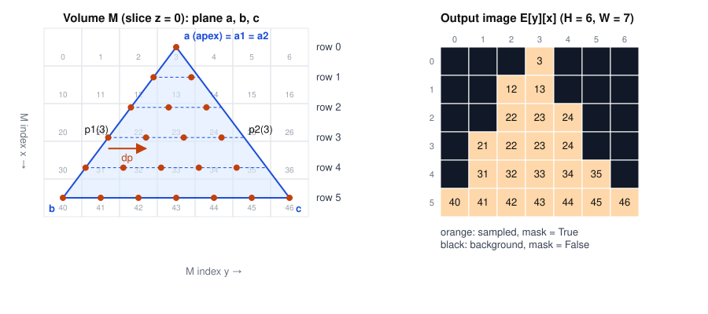

# Algorithm

| Version | Date | Author | Changes |
|---|---|---|---|
| 1.0 | 2026-11-06 | Tzoofe | First version: original algorithm, fixes, corrected algorithm, vectorization, complexity. |
| 1.1 | 2026-11-06 | Tzoofe | Plane size limit, trilinear sampler, worked example with figure, numeric assumptions and invariants. |

This document describes the projection algorithm in detail: the original algorithm this project started from, the problems found in it, the corrected algorithm that is implemented, and how it was made fast. Requirement and design-decision numbers (FR, NFR, DD) refer to [SRS.md](SRS.md).

## 1. Input

- **M**: a 3D array of size sx × sy × sz, indexed `M[x][y][z]` in voxel index coordinates (DD1).
- **A plane**, given as either:
    - a triangle `(a, b, c)` with `dist(a, b) = dist(a, c)` (a is the apex), or
    - a trapezoid `(a1, b, a2, c)` with legs `a1→b` and `a2→c` of equal length (DD2).

All points are real-valued and may lie outside M.

## 2. The original algorithm

```
Dab = dist(a, b) = dist(a, c);  Dbc = dist(b, c)
v(ab) = vector(a, b) / Dab;     v(ac) = vector(a, c) / Dab
E = new matrix of size Dab * Dbc
a1 = a, a2 = a
for (y = 0; y < Dab; y++)
    a1 = a1 + v(ab)
    a2 = a2 + v(ac)
    p = a1
    d12 = dist(a1, a2)
    dp = vector(a1, a2) / d12
    for (x1 = 0; x1 <= d12; x1++)
        v = M[p]                      # if p is not in M, v = 0
        x = (Dbc/2) - (d12/2) + x1
        E[x][y] = v
        p = p + dp
return E
```

The idea: walk two points down the two legs of the triangle, one unit step per output row. Each row is the segment between them, sampled at unit steps and centered horizontally in the output image.

## 3. Problems in the original algorithm, and fixes

| # | Problem | Fix | SRS |
|---|---|---|---|
| 1 | `a1` and `a2` advance **before** the first row is sampled, so the apex row is never sampled. | Row y uses `p1(y) = a1 + y·v1`, so row 0 is the apex. | FR27, DD6 |
| 2 | At the apex `d12 = 0`, so `dp = vector(a1, a2) / d12` divides by zero. | If `d12 < EPS`, sample one point only. | FR28, DD7 |
| 3 | `E` has size `Dab × Dbc`, but both are real numbers. | `H = floor(Dab) + 1` rows (rows 0 to floor(Dab), never past b), `W = ceil(Dbc) + 1` columns (fits the widest centered row). | FR26, DD8 |
| 4 | `x = Dbc/2 - d12/2 + x1` is real, but it is used as an index. | `x = round(Dbc/2 - d12/2 + x1)`. | FR29 |
| 5 | `M[p]` with a real-valued p is undefined. | Nearest voxel: `M[round(p)]`, 0 if outside M. | FR30, DD9 |
| 6 | `E[x][y]` is column-first, while images are row-first. | `E[y][x]`. | FR32, DD10 |
| 7 | Only triangles are described; the trapezoid is mentioned in a note. | A triangle is a trapezoid with `a1 = a2 = a`; one algorithm handles both. | FR24, DD5 |
| 8 | Pixels outside the triangle and pixels outside M both become 0, so they cannot be told apart from voxels whose value is 0. | The projector also returns a boolean **mask** of pixels sampled from inside M; the output stage uses it to keep the background black. | FR37, DD11 |

## 4. Corrected algorithm

```
Input: M, plane (a1, b, a2, c)            # triangle: a1 = a2 = a

Dab = dist(a1, b)
Dbc = dist(b, c)
v1 = (b - a1) / Dab
v2 = (c - a2) / Dab                       # dist(a2, c) = Dab within EPS
H = floor(Dab) + 1
W = ceil(Dbc) + 1
E    = H × W matrix of zeros (same type as M)
mask = H × W matrix of False

for y = 0 .. H-1:
    p1 = a1 + y·v1
    p2 = a2 + y·v2
    d12 = dist(p1, p2)
    if d12 >= EPS:
        dp = (p2 - p1) / d12
        n  = floor(d12) + 1
    else:
        dp = 0
        n  = 1
    for x1 = 0 .. n-1:
        p = p1 + x1·dp
        x = round(Dbc/2 - d12/2 + x1)
        q = round(p)                      # nearest voxel
        if 0 <= x < W:
            if q is inside M:
                E[y][x] = M[q]
                mask[y][x] = True
            else:
                E[y][x] = 0
return E, mask
```

Row 0 lies on the segment `a1→a2` (the apex, for a triangle). Row y lies at distance y from it along the legs. Each row is centered: its middle sample falls at column `Dbc/2`.

### Worked example

A triangle in the slice `z = 0` of a 5×7×1 volume whose voxel values are `M[x][y][0] = 10·x + y`:

```
a = (0, 3, 0)   (apex)      b = (4, 0, 0)      c = (4, 6, 0)
Dab = dist(a, b) = 5        Dbc = dist(b, c) = 6
v1 = (b - a) / 5 = (0.8, -0.6, 0)      v2 = (c - a) / 5 = (0.8, 0.6, 0)
H = floor(5) + 1 = 6        W = ceil(6) + 1 = 7
```



| Row y | p1(y) | p2(y) | d12 | Samples | Columns x | Values |
|---|---|---|---|---|---|---|
| 0 | (0, 3) | (0, 3) | 0 | 1 (d12 < EPS) | 3 | 3 |
| 1 | (0.8, 2.4) | (0.8, 3.6) | 1.2 | 2 | 2, 3 | 12, 13 |
| 2 | (1.6, 1.8) | (1.6, 4.2) | 2.4 | 3 | 2, 3, 4 | 22, 23, 24 |
| 3 | (2.4, 1.2) | (2.4, 4.8) | 3.6 | 4 | 1, 2, 3, 4 | 21, 22, 23, 24 |
| 4 | (3.2, 0.6) | (3.2, 5.4) | 4.8 | 5 | 1 to 5 | 31 to 35 |
| 5 | (4, 0) | (4, 6) | 6 | 7 | 0 to 6 | 40 to 46 |

(The z coordinate is 0 everywhere and is left out.)

Row 1 in detail: the samples are at `p1 + 0·dp = (0.8, 2.4)` and `p1 + 1·dp = (0.8, 3.4)`. Their nearest voxels are `(1, 2)` and `(1, 3)`, with values 12 and 13. Their columns are `round(6/2 - 1.2/2 + 0) = round(2.4) = 2` and `round(3.4) = 3`.

The example also shows one property of the original algorithm: samples are one unit apart starting at `p1`, so when `d12` is not a whole number, the last part of the row (here the last 0.2 voxels of row 1) is not sampled. The row is centered by its full length `d12`, so the sampled pixels can sit up to half a pixel to the left of the center. This is accepted as part of FR28 and FR29.

The properties shown here are checked by tests (see [TESTING.md](TESTING.md)): the apex row has one pixel in the center column, every row is centered, and an axis-aligned plane reproduces the volume's values exactly.

### Numeric assumptions and invariants

- **Precision.** All geometry uses 64-bit floats (about 15 significant digits). Planes are at most 2048 voxels long (FR42), so rounding errors in point positions are around 10⁻¹², far below both EPS (0.001) and the half-voxel distance at which nearest-neighbor rounding changes its answer.
- **EPS = 0.001 voxels** is large enough to accept CSV values written with a few decimal places, and small enough to reject planes that are visibly not isosceles or not flat.
- **Invariants** after a successful `project(data, plane)`:
    - `plane` has passed validation, so `Dab > EPS` and no division by zero can happen.
    - `E` and `mask` have shape `(H, W)` with `H, W >= 1`, and `E` has the same type as M (FR33).
    - Every row has at least one sample (the apex row has exactly one for a triangle).
    - Every written column is in `[0, W)`. This holds by construction because `d12 <= Dbc + EPS`; an explicit filter enforces it anyway, so rounding can never write outside `E`.
    - `mask[y][x]` is True only where a sample was read from inside M; everywhere else `E[y][x] = 0`.

### Plane validation (before projection)

A plane is projected only after it passes validation (FR16 to FR21, DD4), with `EPS = 0.001`:

1. Not degenerate: `dist(a1, b) > EPS`, and `c` is more than EPS from the line `a1 b` (not collinear). These are checked first, because the later checks and the projection divide by these distances.
2. Isosceles: `|dist(a1, b) - dist(a2, c)| < EPS`.
3. Trapezoid only: `dist(a1, a2) <= dist(b, c) + EPS`.
4. Trapezoid only, same plane: the distance of `a2` from the plane through `a1, b, c`, which is `|(a2 - a1) · n| / |n|` with `n = (b - a1) × (c - a1)`, is less than EPS.
5. Not too large: the legs and the base are at most 2048 voxels (FR42, DD13). Coordinates are not limited, so without this check one row could ask for an image that does not fit in memory.

An invalid plane raises `InvalidPlaneError`; the demo turns it into an error frame (DD3).

## 5. Implementation

### Strategy for sampling

`Projector` computes **where** to sample. A `Sampler` object decides **how** to read the value at a real-valued point. `NearestSampler` implements step 5 above for a whole array of points at once: it rounds the points, builds the inside-M mask, and reads only the inside voxels. A different sampler can be passed to `Projector` without changing it (NFR12). `TrilinearSampler` is one: it computes the weighted average of the 8 voxels around each point, with weights from the point's fractional position, and rounds the result to the volume's type. A point is inside when `0 <= p <= size - 1` on every axis, so all 8 voxels exist. It is used in the experiment to compare with nearest-neighbor ([EXPERIMENT.md](EXPERIMENT.md)).

Rounding uses `np.rint`, which rounds exact halves to the nearest even integer (2.5 → 2, 3.5 → 4). It is still nearest-neighbor and deterministic (NFR6).

### Vectorization

Python loops are slow, so the work is expressed as whole-array NumPy operations. This was done in three stages:

| Version | Loops in Python | Speed (500³, 559×501 triangle) |
|---|---|---|
| Direct translation | rows and pixels | ~28 fps on a smaller image |
| `RowLoopProjector` | rows only; each row is one NumPy operation | 100 fps |
| `Projector` | none | 167 fps |

**Row loop.** For one row, all sample points are `p1 + x1[:, None] * dp` for `x1 = 0 .. n-1`: an n×3 array built in one operation. One call to the sampler reads all of them, and one indexed write fills the whole row of E.

**No loop.** Rows have different lengths (a triangle's rows grow from 1 to W samples), so the samples do not form a rectangular grid. They are flattened into one list instead:

```
y      = [0, 1, ..., H-1]
p1, p2 = a1 + y·v1, a2 + y·v2              # H×3, all rows at once
d12    = |p2 - p1|                          # H
counts = floor(d12) + 1   (1 where d12 < EPS)

rows = repeat(y, counts)                    # row of each sample
x1   = [0..counts[0]-1, 0..counts[1]-1, ...] # index of each sample within its row
points = p1[rows] + x1 · dp[rows]           # N×3, N = sum(counts)
values, inside = sampler.sample(M, points)  # one call for the whole image
x = round(Dbc/2 - d12[rows]/2 + x1)
E[rows, x] = values;  mask[rows, x] = inside
```

`x1` is computed as `arange(N) - repeat(row_starts, counts)`, where `row_starts` is the index of each row's first sample (`cumsum(counts) - counts`).

`Projector` and `RowLoopProjector` produce identical results; this is checked by tests on several triangles and trapezoids (see [TESTING.md](TESTING.md)).

### Frame size without projecting

The output size depends only on the plane's geometry (`H = floor(Dab) + 1`, `W = ceil(Dbc) + 1`), so `Projector.output_size(plane)` computes it without sampling. The demo uses it to find the common video frame size (FR38) before the first frame, so frames can be written one at a time and never all kept in memory (NFR4).

## 6. Output stage

1. **Normalization** (FR36, DD11): `v8 = round(255 · (v - Mmin) / (Mmax - Mmin))`, with `Mmin`, `Mmax` the minimum and maximum of the **whole volume**, so the same tissue has the same brightness in every frame. Pixels where `mask` is False stay 0 (black), even for signed data where `Mmin < 0`.
2. **Padding** (FR38, DD12): every frame is placed on a black canvas of the largest projection size, rounded up to even (H.264), centered horizontally and aligned to the top.
3. **Encoding** (FR34): H.264 MP4 at 10 fps.

## 7. Complexity

Let `H ≈ Dab` and `W ≈ Dbc` be the output size, and `N ≤ H·W` the number of samples (about `H·W/2` for a triangle, `H·W` for a rectangle).

- **Time:** O(N) per projection. Each sample costs a constant amount of work: one point, one rounding, one bounds check, one voxel read. Nothing depends on the volume size, so a plane takes the same time whether M is small or large, apart from memory effects.
- **Memory:** O(N) extra for the points and indices (a few dozen bytes per sample), plus O(H·W) for E and mask. The volume is loaded once (NFR4).

In practice, on large rectangles the voxel reads dominate: they jump across a 125 MB array and are limited by memory access, which is why vectorizing does not speed up 500×500 rectangles (see [EXPERIMENT.md](EXPERIMENT.md)).
