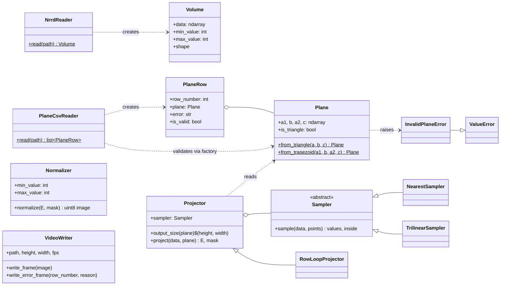
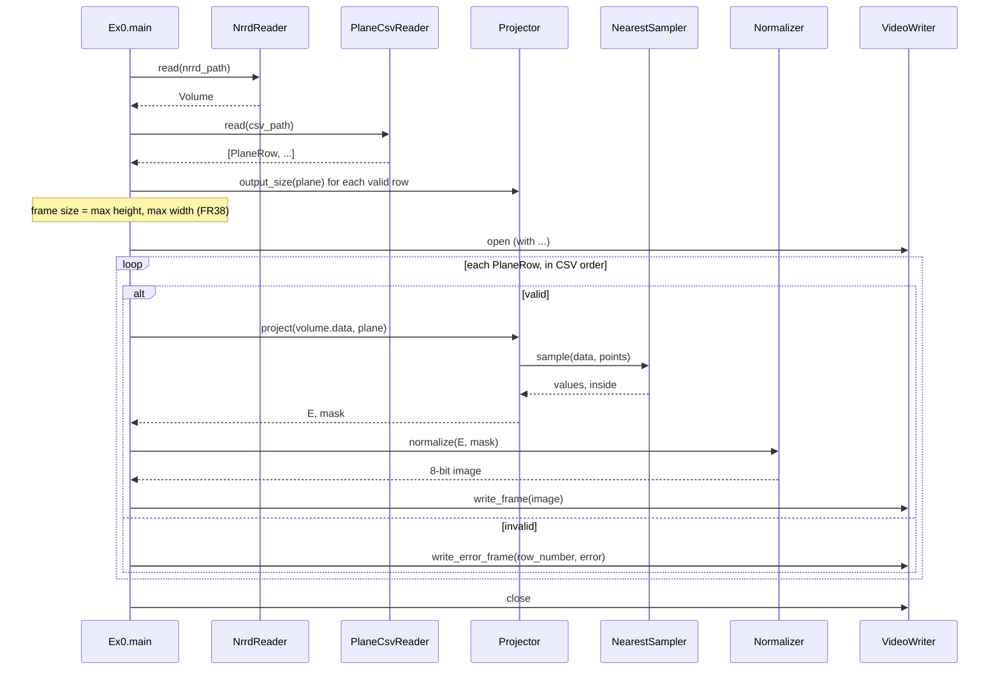

# Software Design

This document describes the classes, their responsibilities, how they work together, and how errors flow through the system. Requirement and design-decision numbers (FR, NFR, DD) refer to [SRS.md](SRS.md); the projection algorithm itself is in [ALGORITHM.md](ALGORITHM.md).

## 1. Design goals

- **One responsibility per class** (NFR10): reading the volume, reading planes, validating a plane, projecting, sampling, normalizing and writing video are separate classes, each testable on its own.
- **The projection does not know about files** (NFR11): `Projector` works on any 3D NumPy array and any `Plane`. NRRD and CSV are handled only at the edges of the system.
- **Replaceable sampling** (NFR12): how a value is read at a real-valued point is a separate object, chosen when the `Projector` is created.
- **Errors are values where the run must continue, exceptions where it must stop**: an invalid CSV row becomes a result with an error message (one bad row must not stop the video, DD3); a missing or broken input file is an exception that ends the run with a clear message (FR7, FR15, FR40).

## 2. Classes

| Class | Module | Responsibility |
|---|---|---|
| `Volume` | `volume.py` | Holds the 3D array M and its global min and max (computed once, used for normalization). |
| `NrrdReader` | `volume.py` | Reads an NRRD file (through pynrrd) and checks FR3 to FR5: dimension 3, sizes 1 to 1023, integer voxel type. |
| `Plane` | `plane.py` | A validated plane, always stored as a trapezoid `(a1, b, a2, c)`; a triangle has `a1 = a2` (DD5). It can only be built through its factory methods, which validate the points (FR16 to FR21, FR42). |
| `InvalidPlaneError` | `plane.py` | The exception for an invalid plane, with the failed condition as its message. A subclass of `ValueError`. |
| `PlaneCsvReader` | `csv_reader.py` | Reads the CSV and returns one `PlaneRow` per data row. Parsing errors and `InvalidPlaneError` are caught here and stored in the row (FR14, FR22). |
| `PlaneRow` | `csv_reader.py` | The result of one row: a `Plane`, or an error message, plus the row number. |
| `Sampler` | `sampler.py` | Abstract interface: read the values of a 3D array at many real-valued points at once, and say which points are inside the array. |
| `NearestSampler` | `sampler.py` | Nearest voxel (FR30, DD9). The sampler used by the command-line program. |
| `TrilinearSampler` | `sampler.py` | Weighted average of the 8 surrounding voxels. Smoother and slower; used in the experiment to compare with nearest. |
| `Projector` | `projector.py` | The projection algorithm, fully vectorized. Computes where to sample, asks its `Sampler` for the values, and returns the image `E` and a `mask` of sampled pixels. |
| `RowLoopProjector` | `projector.py` | The same algorithm with one Python loop iteration per row. Closer to the original algorithm; used as a reference in tests and in the experiment. |
| `Normalizer` | `normalizer.py` | Converts `E` to 8-bit with the volume's global min/max; pixels outside the mask stay black (FR36, FR37). |
| `VideoWriter` | `video_writer.py` | Pads every frame to one even size, draws error frames, and writes the H.264 MP4 (FR34 to FR41). Used as a context manager so the file is always closed. |
| `main` | `Ex0.py` | The command-line program: connects the classes, prints warnings and timing, turns fatal errors into exit codes. |

## 3. Design patterns

- **Strategy** (`Sampler`, `NearestSampler`, `TrilinearSampler`): `Projector` receives a sampler in its constructor and only calls `sample(data, points)`. Changing the sampling method is done by passing another object; `Projector` does not change. A test passes a fake sampler that always returns 7 to show that `Projector` depends only on the interface.
- **Factory methods** (`Plane.from_triangle`, `Plane.from_trapezoid`): the only way to create a valid `Plane`. Every `Plane` in the system has passed validation, so `Projector` does not check the geometry again.
- **Context manager** (`VideoWriter`): `with VideoWriter(...) as writer:` opens the video and always closes it, also when an error happens in the middle.
- **Result object** (`PlaneRow`): instead of stopping at the first bad row, the reader returns a result for every row, valid or not. This keeps the mapping CSV row i → video frame i (FR35).
- **Inheritance for an alternative implementation** (`RowLoopProjector` extends `Projector`): it reuses `output_size` and the constructor, and overrides only `project`. Because both have the same interface, tests can compare them directly.

## 4. Data flow

The frame size is computed from the plane geometry before the first frame is written, so frames are written one at a time and never all kept in memory (NFR4).

## 5. Errors

| Error | Raised by | Handled by | Result |
|---|---|---|---|
| Missing file | `open` (`FileNotFoundError`) | `Ex0.main` | message, exit code 1 (FR7, FR15) |
| Bad NRRD: not NRRD, not 3D, size out of range, unsupported type | `NrrdReader` (`ValueError`) | `Ex0.main` | message, exit code 1 (FR7) |
| CSV not text, or no data rows | `PlaneCsvReader` (`ValueError`) | `Ex0.main` | message, exit code 1 (FR15) |
| Bad CSV row: invalid N, missing or non-numeric value, wrong count | `PlaneCsvReader` | stored in `PlaneRow.error` | warning + error frame (FR14) |
| Invalid plane geometry, plane too large | `Plane` (`InvalidPlaneError`) | caught by `PlaneCsvReader`, stored in `PlaneRow.error` | warning + error frame (FR22, FR42) |
| Output cannot be written | `VideoWriter` (`OSError`) | `Ex0.main` | message, exit code 1 (FR40) |
| Wrong number of arguments | `Ex0.main` | `Ex0.main` | usage message, exit code 2 (NFR9) |
| Anything unexpected | anywhere | last-resort handler in `Ex0.py` | message, exit code 1, never a traceback (NFR5) |

## 6. Extending the system

- **Another sampling method**: subclass `Sampler`, implement `sample`, and pass it to `Projector`. Nothing else changes.
- **Another input format** (for example DICOM): add a reader that returns a `Volume`. `Projector`, `Normalizer` and `VideoWriter` do not change.
- **Another output** (for example PNG images instead of a video): replace `VideoWriter`; the projection and normalization do not change.
